  

# 📱 Awesome Responsive Design & Multi-Screen Testing 🚀

  
  
  
  
  
  

> 🌟 **A curated list of top Responsive Design and Multi-Screen Testing platforms** — featuring commercial SaaS/cloud ecosystems and battle-tested open-source dev browsers, interaction mirrors, and visual regression suites for previewing, debugging, and certifying modern web applications across breakpoints, mobile viewports, tablets, and desktop displays.
>
> 💡 *Star this repo if you find it useful for your frontend and QA workflows!* ⭐

---

## 📋 Table of Contents

- [🌐 Sector Overview & Market Dynamics](#-sector-overview--market-dynamics)
- [🟦 SaaS / Hosted Platforms](#-saas--hosted-platforms)
- [🟩 Open-Source Software](#-open-source-software)
- [📊 Comparison at a Glance](#-comparison-at-a-glance)
- [📈 Star History](#-star-history)
- [💖 Support & Sponsorship](#-support--sponsorship)
- [🤝 Contributing](#-contributing)
- [📄 License](#-license)

---

## 🌐 Sector Overview & Market Dynamics

The global software testing and cross-browser quality assurance market is valued at over **$40–$45 Billion** and is projected to expand steadily at an ~8–10% CAGR, accelerated by rapid multi-device proliferation, mobile-first indexing, and modern CI/CD automation pipelines.

The industry exhibits a **hybrid market structure**: the enterprise cloud testing and device infrastructure layer is **moderately concentrated** among heavyweight market leaders (e.g., BrowserStack, Sauce Labs, LambdaTest), whereas the developer-local workbench and responsive layout debugging ecosystem remains **highly fragmented**, populated by specialized independent browsers (Polypane, Sizzy) and thriving open-source responsive tooling (Responsively App, Browsersync, BackstopJS).

---

## 🟦 SaaS / Hosted Platforms

Commercial, cloud-hosted, and desktop developer platforms offering real-device clouds, synchronized interaction mirrors, and multi-viewport inspection.

| Platform 🛠️ | Company Scale (Valuation / Revenue) 🏢 | Pricing (Starting Paid Tier) 💳 | Free Tier / Free Trial Limits ⏳ | Key Features ⚡ | Best For 🎯 |
| :--- | :--- | :--- | :--- | :--- | :--- |
| **[BrowserStack](https://www.browserstack.com/)** | **Valuation: ~$4.0B** Revenue: ~$225M–$230M ARR | **$29/month** (billed annually) or **$39/month** (billed monthly) for Live Desktop; **$39/month** (annual) for Desktop & Mobile | **Free Trial:** 30 minutes total of Live interactive testing (approx. 1 min/session per device) + 100 screenshots & responsive test executions | Real-device cloud with 30,000+ actual devices, simultaneous multi-device comparison, synced clicks/scrolls, instant local testing tunneling | Teams needing absolute ground-truth validation across physical iOS/Android hardware and enterprise desktop setups |
| **[LambdaTest](https://www.lambdatest.com/)** | **Valuation: ~$400M** Revenue: ~$20M–$40M ARR | **$15/month** (billed annually) for Virtual Live Testing; **$79/month** for Desktop Automation | **Free Forever Plan:** 60 mins/month live interactive testing (10-min sessions), 100 lifetime automation minutes, 1 parallel session, 100 accessibility tests | Dedicated Chromium LT Browser with 50+ pre-installed device viewports, integrated screenshot bug-capture/annotator, Lighthouse auditing | QA engineers and frontend developers seeking built-in bug capture, reporting, and real-time parallel browser emulation |
| **[Sizzy](https://sizzy.co/)** | **Bootstrapped** Revenue: ~$500K–$1M+ ARR | **$12/month** (billed annually at $144/yr) or **$15/month**; Lifetime license at **$499** | **Free Trial:** 14-day fully-unlocked trial with complete access to all 19+ tabs, device viewports, and workspaces | Multi-device synced previews, unified console multiplexing logs across viewports, embedded coding agents (Claude Code, Codex), Photo Studio mockups | Solo developers and agile frontend teams wanting an all-in-one responsive workbench, terminal, and AI assistant |
| **[Polypane](https://polypane.app/)** | **Bootstrapped** Revenue: Micro-SaaS (~$200K–$500K ARR) | **€9/month** (approx. $10–$11/mo billed annually) or **€12/month** for Individual; **$39/seat/month** for Business | **Free Trial:** 14-day fully functional free trial with full access to 40+ developer tools; free via GitHub Student Developer Pack | Side-by-side synchronized viewport panes (mobile to 5K/breakpoints), complete device emulation, 40+ built-in a11y & SEO audit tools, Polypane Portal sharing | Developers, UI/UX designers, and accessibility specialists seeking a deep, unified responsive engineering browser |

---

## 🟩 Open-Source Software

Community-driven, self-hosted responsive browsers, synchronized testing utilities, and automated visual regression frameworks. Repositories are ranked below by community GitHub star count.

### 1. [Responsively App](https://github.com/responsively-org/responsively-app)

* **Stack:** TypeScript / Electron 💻 | **License:** AGPL-3.0 📜
* **Repository:** [responsively-org/responsively-app](https://github.com/responsively-org/responsively-app) 🔗
* **Description:** A dedicated open-source web browser crafted specifically for responsive frontend development. It renders all target device viewports side-by-side in a single window with automatic real-time mirroring of clicks, scroll positions, navigation, and text inputs across every active preview. Bundles an integrated element inspector, 30+ device presets, customizable screen layouts, and one-click full-page screenshot exports.
* **Best For:** Developers wanting an instant, free, self-hosted responsive browser with live cross-device interaction mirroring.

### 2. [Browsersync](https://github.com/BrowserSync/browser-sync)

* **Stack:** Node.js / JavaScript 🌐 | **License:** Apache-2.0 📜
* **Repository:** [BrowserSync/browser-sync](https://github.com/BrowserSync/browser-sync) 🔗
* **Description:** The industry-standard tool for synchronized cross-device testing and live reloading. Browsersync creates a local development server or proxies an existing server, keeping multiple physical devices, virtual simulators, and browser tabs seamlessly synchronized in scroll, click, form inputs, and live code reloads.
* **Best For:** Testing responsiveness simultaneously on real physical phones, tablets, and multi-monitor setups during local coding.

### 3. [BackstopJS](https://github.com/garris/BackstopJS)

* **Stack:** Node.js / Playwright / Puppeteer 🤖 | **License:** MIT 📜
* **Repository:** [garris/BackstopJS](https://github.com/garris/BackstopJS) 🔗
* **Description:** Leading automated visual regression testing framework designed specifically for responsive web UI layouts. BackstopJS renders your web pages across an arbitrary list of configurable viewport dimensions, captures deterministic DOM snapshots, compares them against curated baselines, and generates interactive visual diff HTML reports highlighting pixel shifts and breakpoint collisions.
* **Best For:** Automated CI/CD pipelines catching unexpected layout breakage across phone, tablet, and widescreen breakpoints.

### 4. [Responsivize](https://github.com/virejdasani/Responsivize)

* **Stack:** JavaScript / Electron 🖥️ | **License:** MIT 📜
* **Repository:** [virejdasani/Responsivize](https://github.com/virejdasani/Responsivize) 🔗
* **Description:** A clean, lightweight desktop application designed to test web applications across customizable viewport dimensions and popular device presets (iOS devices, Android models, tablets, and ultra-wide screens) concurrently. Includes quick orientation flipping, zoom adjustments, and isolated device previewing.
* **Best For:** Quick responsive layout inspection on desktop without complex configuration.

### 5. [Am I Responsive?](https://github.com/justincavery/am-i-responsive)

* **Stack:** JavaScript / HTML / CSS 📐 | **License:** MIT 📜
* **Repository:** [justincavery/am-i-responsive](https://github.com/justincavery/am-i-responsive) 🔗
* **Description:** A browser-based responsive mockup and verification utility that displays your live website embedded simultaneously into four realistic viewport mockups: Desktop (1600x992), Laptop (1280x802), Tablet (768x1024), and Mobile (320x480). Ideal for rapid visual sanity checks and portfolio presentations.
* **Best For:** Client presentations, quick responsiveness checks, and generating multi-screen visual mockups.

### 6. [ui-diff](https://github.com/albingroen/ui-diff)

* **Stack:** TypeScript / Node.js 🔍 | **License:** MIT 📜
* **Repository:** [albingroen/ui-diff](https://github.com/albingroen/ui-diff) 🔗
* **Description:** A live UI regression and responsive debugging utility for web applications. Features real-time viewport diffing, layout overflow detection with selector root-cause attribution, and accessibility delta tracking across changing screen widths.
* **Best For:** Developers requiring focused overflow detection and automated breakpoint regression tests in terminal workflows.

---

## 📊 Comparison at a Glance

| Software 🛠️ | Delivery Model 📦 | License 📜 | Multi-Viewport View 🖥️ | Synchronized Input 🔄 | Visual Regression 🎯 | Accessibility / SEO Auditing 🔍 |
| :--- | :--- | :--- | :--- | :--- | :--- | :--- |
| **BrowserStack** | Cloud SaaS | Proprietary | ✅ Real Cloud Hardware | ✅ Synced Sessions | ✅ Visual Review / Percy | ✅ Integrated Audits |
| **LambdaTest** | Cloud / Desktop | Proprietary | ✅ 50+ Device Emulators | ✅ Cross-Device Mirroring | ✅ SmartUI Visual Diff | ✅ Lighthouse & A11y |
| **Sizzy** | Desktop App | Proprietary | ✅ Side-by-Side Panes | ✅ Full Event Sync | ✅ Visual Snapshot Diff | ✅ DevTools & Console Hub |
| **Polypane** | Desktop App | Proprietary | ✅ Multi-Viewport Grid | ✅ Complete Event Mirror | ✅ Breakpoint Testing | ✅ 40+ Built-In Audits |
| **Responsively App** | Desktop App | AGPL-3.0 | ✅ Unlimited Devices | ✅ Real-Time Mirroring | ⚠️ Basic Snapshots | ⚠️ Element Inspector |
| **Browsersync** | CLI / Local Proxy | Apache-2.0 | ✅ Physical & Emulated | ✅ Multi-Browser Sync | ❌ External Plugin | ❌ External Tools |
| **BackstopJS** | CLI / CI Automation | MIT | ✅ Configurable Viewports | ❌ Scripted Actions | ✅ Pixel-by-Pixel Diff | ❌ Layout Diff Focused |
| **Responsivize** | Desktop App | MIT | ✅ Preset Device Grid | ❌ Independent Panes | ❌ Manual Verification | ❌ DevTools |
| **Am I Responsive?** | Web App | MIT | ✅ 4 Core Breakpoints | ❌ Independent Frames | ❌ Visual Mockup Only | ❌ Preview Tool |
| **ui-diff** | CLI / Dev Server | MIT | ✅ Live Device Wall | ⚠️ Live Dev Watch | ✅ Root-Cause Regression | ✅ A11y Delta Tracking |

---

## 📈 Star History

---

## 💖 Support & Sponsorship

If this curated collection helped streamline your responsive design workflow, consider supporting its ongoing maintenance and updates!

- ⭐ **Star** this repository on GitHub to help others discover it.
- 🍴 **Fork** and contribute new tools, updates, or benchmark findings.
- 📢 **Share** with frontend teams, QA specialists, and design engineers.
- ☕ **Sponsor**: Support open-source curation and development via the [GitHub Sponsor Dashboard](https://github.com/sponsors/ishandutta2007).

---

## 🤝 Contributing

Contributions are always welcome! 🚀 If you know of an outstanding responsive design, cross-viewport previewer, or visual regression testing tool:

1. Fork this repository.
2. Add your suggested entry to the appropriate section in alphabetical or sorted order.
3. Include links, technology stack, license, pricing/free tier specifics (if SaaS), and primary benefits.
4. Ensure the project is actively maintained (active releases or commits within the past 12 months).
5. Submit a pull request with a descriptive title and summary.

---

## 📄 License

This compilation is licensed under the [Creative Commons Zero v1.0 Universal](LICENSE) (CC0 1.0) Public Domain Dedication. All product names, logos, and brands are property of their respective owners.

---

  ⭐ <b>Found this valuable? Don't forget to star the repository!</b> ⭐

